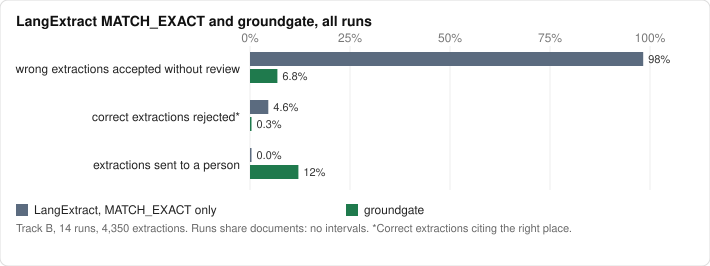

<picture>
  <source media="(prefers-color-scheme: dark)" srcset="docs/brand/groundgate-mark-dark.svg">
  
</picture>

# groundgate

**LLMs propose facts. groundgate decides which ones you can trust.**

Release: main, before 1.0.0 (spec 0.13).

An LLM extracts most values from a document correctly, but not all. A wrong value often cites a
real place in the document, so a check of the quote does not find it. groundgate checks the
value itself: the number, its sign, its scale, its unit and its key, against the text that the
value cites. It uses fixed rules and no model in the decision.

You give groundgate a document, a schema and the facts that an extractor proposed. Each fact
gets one of three outcomes:

- **admitted**: every check passed;
- **needs_verification**: nothing failed, but a person must look, and the codes say why;
- **rejected**: a check failed, with a stable reason code.

Each run writes a receipt with a hash of each input. Anyone can derive the receipt again, byte for
byte. groundgate is for developers who store values that an LLM extracts from documents, such as
limits, amounts, doses and dates, and who must know which values a person has to check.

## Quickstart

Install [uv](https://docs.astral.sh/uv/), then get the code:

```bash
git clone https://github.com/mohanraj00/groundgate.git
cd groundgate
uv sync --no-dev
```

Save this as `quickstart.py`, and run it with `uv run python quickstart.py`:

```python
import groundgate as gg

text = "The IRA contribution limit is $7,000. The deduction phases out above $79,000."
schema = {
    "fields": {
        "ira_limit": {"type": "integer", "unit": "USD"},
        "phaseout_start": {"type": "integer", "unit": "USD"},
    }
}


def cite(field, value, quote):
    """A candidate whose evidence is a quote: groundgate finds it in the text."""
    return {"field": field, "value": value, "unit": "USD", "evidence": [{"text": quote}]}


candidates = [
    cite("ira_limit", "7000", "$7,000"),
    cite("ira_limit", "70000", "$7,000"),  # a digit too many
    cite("phaseout_start", "79000", "$79,000"),  # "above" is not "at"
]
receipt = gg.admit(text, schema, candidates)
for d in receipt.decisions:
    print(f"{d.outcome:<19} {d.field:<15} {d.value:<6} {' '.join(d.codes)}".rstrip())

print(gg.verify(receipt.to_dict(), text, schema, candidates).ok)
```

```text
rejected            ira_limit       70000  VALUE_NOT_IN_EVIDENCE
needs_verification  phaseout_start  79000  QUALIFIED_VALUE
admitted            ira_limit       7000
True
```

The same check from the command line, with the files in [docs/quickstart/](docs/quickstart):

```bash
uv run groundgate admit docs/quickstart/doc.txt docs/quickstart/schema.json docs/quickstart/candidates.json -o receipt.json
uv run groundgate verify receipt.json docs/quickstart/doc.txt docs/quickstart/schema.json docs/quickstart/candidates.json
```

```text
receipt verified
```

`receipt.json` has the three decisions and their codes. `verify` decides again from the inputs
and fails on each difference. In your own project, `pip install groundgate` installs the same
package. The core has no dependencies. The extras `groundgate[pdf]`, `groundgate[ocr]` and
`groundgate[langextract]` add PDF text, OCR of scanned pages and the LangExtract adapter.

## Next

- [docs/README.md](docs/README.md): a how-to page for each task, and one page for each command
  and each function.
- [docs/schema.md](docs/schema.md): write a schema for your documents.
- [docs/howto/own-model.md](docs/howto/own-model.md): from a document and your own model to a
  receipt.
- [docs/guide.md](docs/guide.md): the reference for each input, each policy key and each code.
- [SPEC.md](SPEC.md): the rules of each decision. [conformance/](conformance) has the vectors
  that another implementation must pass.
- [examples/irs-590a](examples/irs-590a): the full pipeline on an IRS publication, with cached
  model output, so it runs again with no API key.

## Benchmark

Seven models (Gemini, GPT and Claude, each through its own CLI) ran through LangExtract on 30
public-domain FDA drug labels, NTSB accident reports and IRS publications, at two chunk sizes. A
person checked each gold fact. These are the published numbers of spec 0.1 on the first set. Of
4,350 extractions, 117 were wrong: the wrong value, a value for a field that the document does not
state, the wrong unit, or not a number.



| | LangExtract, `MATCH_EXACT` | groundgate |
|---|---:|---:|
| wrong extractions accepted without review | 98.3% (115/117) | 6.8% (8/117) |
| correct extractions citing the right place, rejected | 4.6% (194/4,233) | 0.3% (14/4,233) |
| extractions sent to a person | 0% | 12.1% (526/4,350) |
| gold facts admitted with a right value | 92.5% (3,588/3,878) | 87.1% (3,379/3,878) |

A gold fact is one value that a document states for a field, so a field with 12 strengths counts
12 times, and each fact counts once in each run. groundgate admits fewer right facts than
`MATCH_EXACT`, and admits 8 wrong values instead of 115. With the reviews, 96.5% (3,742/3,878)
of gold facts get a right value.

The goal is fewer misses on the fields that an app asks for, with 0 escapes. This table has one
row for each release with a requested-fields run. Each row is the `groundgate.extract` arm, and
`bench/report.py --goal-table` writes the table from each set's `results.json`.

<!-- goal-table:start -->

| Release | Set | Split | Documents | Right admits | Reviews | Rejected right | Escapes | Miss rate |
|---|---|---|---:|---:|---:|---:|---:|---:|
| 0.9 | `bench/requested` | heldout | 61 | 16 | 119 | 60 | 0 | 180/196 (91.84%) |
| 0.10 | `bench/requested3` | heldout | 111 | 97 | 160 | 16 | 0 | 208/305 (68.20%) |
| 0.11 | `bench/requested4` | heldout | 59 | 79 | 97 | 21 | 1 | 125/204 (61.27%) |
| 0.12 | `bench/requested4/development` | development | 32 | 46 | 62 | 13 | 1 | 76/122 (62.30%) |
| 0.13 | `bench/requested4/development-464` | development | 32 | 50 | 58 | 14 | 2 | 72/122 (59.02%) |
| 0.14 | `bench/requested4/development-646` | development | 32 | 48 | 69 | 2 | 0 | 74/122 (60.66%) |

<!-- goal-table:end -->

The miss rate is reviews plus silent misses over the stated values. A rejected right value is a
silent miss for which the model proposed the right value. The rows use different sets, so only
rows on one set and one split compare directly: 0.12 and 0.13. The development split is for
tuning, so its rows are not a claim.

[bench/README.md](bench/README.md) has each set, with its tables, method and limits. The write-up
tells which wrong values got through, and why:
[Grounding is a contract, not a citation](https://mohanraj00.github.io/tech/grounding-is-a-contract/).

## What it does not do

- **It does not judge meaning.** If the model reports a number that is in the sentence but
  belongs to another field, each span check passes. A second proposer and
  `CONFLICTING_CANDIDATES` find it only when the models disagree. In the benchmark, six of the
  eight escapes were this case. If the field depends on a condition that the schema can name, a
  keyed field checks it.
- **English number formats only.** A decimal comma (`1.234,56`), space groups (`1 234`) and
  number words (`five`) have no value, so a fact that cites them is rejected. The
  [guide](docs/guide.md#how-values-are-read) lists what groundgate reads.
- **OCR is optional.** `groundgate read --ocr` reads English only, extracts no table structure
  from scans, and reads at most 200 pages in one run.
- **No model calls in the decision.** groundgate reads the answers of a judge only as recorded
  inputs, so a receipt still derives again byte for byte. The judge block is experimental.
- **Too many reviews on requested fields.** On the development split of `bench/requested4`,
  0.14 admits no wrong value (0 escapes) and rejects 2 right values, but it sends 69 of the 122
  stated values to review against a target of 35 or fewer. Its miss rate is 60.66% (74 of 122)
  against a target of 40% or less
  ([bench/requested4/development-646/RESULTS.md](bench/requested4/development-646/RESULTS.md)).
  I did not run `bench/requested4` for 0.15, 0.16 or 0.17. On the held-out regulatory text
  family, 0.17 gives 28 right admitted values, 6 escapes and 4 reviews on 50 slots, a miss rate
  of 28.21% and a one-sided 95% upper bound of 31.89% on the admitted error rate
  ([bench/regulatory/RESULTS.md](bench/regulatory/RESULTS.md)).
- **An admitted passage or table is not checked as a whole.** Each member value of an admitted
  `record` passed its own checks, but the gate does not check that the values come from one row,
  or that the records are all the rows of the table. In the regulatory held-out run of 0.17, 4 of
  22 admitted passages and 2 of 5 admitted tables were escapes. The one-sided 95% upper bounds on
  the admitted error rate are 36.91% for `passage` and 81.07% for `record`
  ([bench/regulatory/ESCAPES.md](bench/regulatory/ESCAPES.md)). If a passage or a table must be
  exact, send it to review.

## Status

Alpha. The main branch implements spec 0.13. groundgate 0.17.0 on PyPI is the last release of
spec 0.12. A receipt names the spec version that decided it, and only a release with that spec
version verifies it. [CHANGELOG.md](CHANGELOG.md) lists what
each version changes, with its measure.

## License

Apache-2.0.
