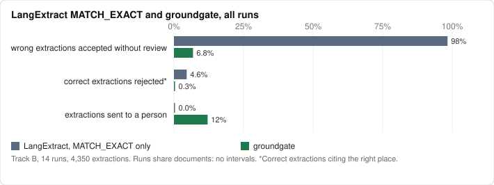

<picture>
  <source media="(prefers-color-scheme: dark)" srcset="docs/brand/groundgate-mark-dark.svg">
  
</picture>

# groundgate

**LLMs propose facts. groundgate decides which ones you can trust.**

## The problem

LLMs extract most values from a document correctly, but not all. In the benchmark below, 4,233 of
4,350 extractions were correct. Each of the other 117, about 1 in 37, cited a real place in the
document. So nothing on the page tells you which values are wrong.

Grounded extraction tools check that the quoted text exists in the source. They do not check the
value that you store: a scale word that the model dropped, a sign it missed, or the limit from the
next line.

## The solution

groundgate is a deterministic admission layer for LLM document extraction. It checks each
proposed value against the text that the value cites, with fixed rules and no model in the
decision. You give it a document, a schema, and the facts an extractor proposed. Every fact comes
back with one of three outcomes:

- **admitted**: every check passed;
- **needs_verification**: nothing failed, but a person should look, and the decision says where;
- **rejected**: a check failed, with a stable reason code.

Every run writes a receipt with hashes of every input. Anyone can re-derive it byte for byte.

The goal is to admit as many fields as possible with the right value, while wrong values almost
never get in. I judge every rule by two numbers: the facts admitted with a right value, and the
wrong extractions admitted (escapes). Reviews are the cost between them: each one is a value that
a person confirms by hand.


## Why this exists

Grounded extraction tools check that the quoted **text** exists in the source. They don't check
the **value** you store. LangExtract is the clearest example, and a good tool. It aligns each
`extraction_text` to the source and reports `MATCH_EXACT`, `MATCH_FUZZY` and so on. It never
looks at the attributes that hold the typed value.

A real case from the benchmark: IRS Publication 560 states two limits a few lines apart.

```text
The limit on elective deferrals, other than catch-up contributions, is $23,500 for 2025 ...
The limit on salary reduction contributions, other than catch-up contributions, is $16,500 for 2025 ...
```

The first is the 401(k) limit. The second is the SIMPLE plan limit. Asked for the 2025 elective
deferral limit, 4 of 14 runs proposed both, and LangExtract marked both quotes `MATCH_EXACT`.
groundgate sent both to a person with `CONFLICTING_CANDIDATES`, because two proposals for one
field disagree. In Publication 15-B, one model stored "$1 million" as 1, also an exact match, and
groundgate flagged it `SCALE_WORD`.

The same gap shows up on the document I used while building the library. I ran Gemini 3.6 Flash and GPT-OSS 120B through
LangExtract on two pages of IRS Publication 590-A. LangExtract aligned all 48 extractions as
`MATCH_EXACT`. groundgate then:

- **rejected** Gemini's reading of a misprinted `$252,0000` as 2,520,000;
- **flagged** three GPT-OSS facts: two took a Roth IRA limit from the spousal-deduction
  sentence, where the numbers match but the text says "more than" where the field says "at
  least", and one is a right value next to an "or more" that the schema did not declare;
- **listed** a required field both models missed;
- **admitted** 44 facts, all with the right value.

One admitted fact still cites the wrong rule. Its number is correct, its comparator matches, and
no span check can tell. I checked every decision by hand; the details are in
[examples/irs-590a](examples/irs-590a), which is also the page in the screenshot.

I measured the gap on purpose before writing the library. On 51 facts from two public-domain
government documents, LangExtract's strictest setting (`MATCH_EXACT` only) accepted **100%** of
planted value and unit errors whose quote was correct. groundgate caught **all** of them and
rejected **none** of the correct facts. The method and full tables are in
[spikes/m0_5](spikes/m0_5/README.md).

LangExtract locates the text. groundgate checks the number in it.

## Quickstart

```bash
pip install groundgate
```

```python
import groundgate as gg

text = "The IRA contribution limit is $7,000. The deduction phases out above $79,000."
schema = {
    "fields": {
        "ira_limit": {"type": "integer", "unit": "USD"},
        "phaseout_start": {"type": "integer", "unit": "USD"},
    }
}


def cite(field, value, quote):
    """A candidate whose evidence is a quote: groundgate finds it in the text."""
    return {"field": field, "value": value, "unit": "USD", "evidence": [{"text": quote}]}


candidates = [
    cite("ira_limit", "7000", "$7,000"),
    cite("ira_limit", "70000", "$7,000"),  # a digit too many
    cite("phaseout_start", "79000", "$79,000"),  # "above" is not "at"
]
receipt = gg.admit(text, schema, candidates)
for d in receipt.decisions:
    print(f"{d.outcome:<19} {d.field:<15} {d.value:<6} {' '.join(d.codes)}".rstrip())

print(gg.verify(receipt.to_dict(), text, schema, candidates).ok)
```

```text
rejected            ira_limit       70000  VALUE_NOT_IN_EVIDENCE
needs_verification  phaseout_start  79000  QUALIFIED_VALUE
admitted            ira_limit       7000
True
```

The core has no dependencies. `groundgate[pdf]` adds pdfminer.six for PDF text,
`groundgate[ocr]` adds pypdfium2 to OCR scanned pages with the `tesseract` program (opt-in), and
`groundgate[langextract]` installs LangExtract. [docs/](docs/README.md) has a guide to writing a
schema, a how-to guide for each task, and [the reference](docs/guide.md). An evidence item can also give UTF-8 byte offsets
(`start`, `end`), and it can cite the sign, scale, unit, field or key of the value (spec 0.5).

### With your own model

`gg.extractor_schema(schema)` turns your schema into a JSON Schema for the model's structured
output, so the model sends only your fields, units and keys, and quotes its evidence.
[docs/howto/own-model.md](docs/howto/own-model.md) goes from a document to a receipt, and
[docs/howto/feedback.md](docs/howto/feedback.md) sends the reasons back to the model.

### With LangExtract

```python
import langextract as lx
from groundgate.adapters.langextract import admit_document

result = lx.extract(text_or_documents=text, prompt_description=prompt, examples=examples)
receipt = admit_document(result, schema)
```

Each extraction's `value` and `unit` attributes are checked at the place LangExtract aligned its
`extraction_text`. The attributes `sign_text`, `scale_text`, `unit_text`, `field_text` and
`key_text` become role items. `field_text` can be a list, such as a row label and a column
header, for up to 8 field items. `source_url` (with `source_quote` and `source_retrieved`) or
`knowledge` becomes outside evidence. An extraction that LangExtract could not align, with no
outside evidence, is rejected `NO_EVIDENCE`.

### From the command line

```bash
groundgate read p590a.pdf --pages 1-2 -o doc.txt --layout layout.json
groundgate admit   doc.txt schema.json candidates.json -o receipt.json
groundgate admit   --docs docs --candidates candidates --schema schema.json --out receipts
groundgate verify  receipt.json doc.txt schema.json candidates.json
groundgate report  receipt.json doc.txt schema.json candidates.json --layout layout.json -o report.html
groundgate schema  schema.json -o extractor.schema.json
groundgate schema check schema.json
```

`read` turns a PDF, HTML, XML, DOCX, XLSX or text file into the NFC text everything else reads,
and records the page and box of every word of a PDF. Text a reader can't see (proof marks drawn
off the page, hidden HTML, hidden runs, sheets, rows and columns) is dropped, and superscripts are marked so that 10⁹ reads `10^9`, never `109`.
`admit`, `verify` and `report` read the document from a pipe when DOC is `-`, and also take
`--references`, `--document-source` and `--pack`. `report` refuses to render a receipt that doesn't
re-derive from its inputs. `schema` writes the extractor schema, and `schema check` prints the
settings that make a check fail every time, or pass for the wrong key or field
([Check a schema](docs/schema.md#check-a-schema)).
[examples/irs-590a](examples/irs-590a) runs the whole pipeline on an IRS publication with cached model output, so it reproduces without an API key.

For a batch, `--docs` holds `<doc>.txt` files and `--candidates` holds matching `<doc>.json`
candidate arrays. `--out` receives one receipt per document and `summary.json` with outcome and
code counts per document and in total, and the CLI prints the totals. With `--store DIR`, each
document also gets a packet, and `summary.json` names its key. The
[guide](docs/guide.md#command-line) describes missing and empty candidate files, shared policy
and references, per-document judgments, and the batch options and summary format.

## Benchmark

Seven models (Gemini, GPT and Claude, each through its own CLI) ran through LangExtract on 30
public-domain FDA drug labels, NTSB accident reports and IRS publications, at two chunk sizes. A
person checked every gold fact. These are spec 0.1's numbers on the first set, as published. Of 4,350 extractions, 117 were wrong: the wrong value, a value
for a field the document doesn't state, the wrong unit, or not a number.



| | LangExtract, `MATCH_EXACT` | groundgate |
|---|---:|---:|
| wrong extractions accepted without review | 98.3% (115/117) | 6.8% (8/117) |
| correct extractions citing the right place, rejected | 4.6% (194/4,233) | 0.3% (14/4,233) |
| extractions sent to a person | 0% | 12.1% (526/4,350) |
| gold facts admitted with a right value | 92.5% (3,588/3,878) | 87.1% (3,379/3,878) |

A gold fact is one value that a document states for a field, so a field with 12 strengths counts
12 times, and each fact counts once in each run. groundgate admits fewer right facts than
`MATCH_EXACT`, and lets in 8 wrong values instead of 115. With the reviews, 96.5% (3,742/3,878)
of gold facts get a right value.

The goal is fewer misses on the fields that an app asks for, with 0 escapes. This table has one
row for each release with a requested-fields run. Each row is the `groundgate.extract` arm, and
`bench/report.py --goal-table` writes the table from each set's `results.json`.

<!-- goal-table:start -->

| Release | Set | Split | Documents | Right admits | Reviews | Rejected right | Escapes | Miss rate |
|---|---|---|---:|---:|---:|---:|---:|---:|
| 0.9 | `bench/requested` | heldout | 61 | 16 | 119 | 60 | 0 | 180/196 (91.84%) |
| 0.10 | `bench/requested3` | heldout | 111 | 97 | 160 | 16 | 0 | 208/305 (68.20%) |
| 0.11 | `bench/requested4` | heldout | 59 | 79 | 97 | 21 | 1 | 125/204 (61.27%) |
| 0.12 | `bench/requested4/development` | development | 32 | 46 | 62 | 13 | 1 | 76/122 (62.30%) |
| 0.13 | `bench/requested4/development-464` | development | 32 | 50 | 58 | 14 | 2 | 72/122 (59.02%) |

<!-- goal-table:end -->

The miss rate is reviews plus silent misses over the stated values. A rejected right value is a
silent miss for which the model proposed the right value. The rows use different sets, so only
rows on one set and one split compare directly: 0.12 and 0.13. The development split is for
tuning, so its rows are not a claim.

Each set, with its tables, method and caveats: [bench/README.md](bench/README.md). The write-up,
with what got through and why:
[Grounding is a contract, not a citation](https://mohanraj00.github.io/tech/grounding-is-a-contract/).

## What it checks

Checks run in a fixed order. The first failure rejects the fact.

| Code | Rejects when |
|---|---|
| `CANDIDATE_INVALID` | the candidate is malformed |
| `FIELD_UNKNOWN` | the field is not in the schema |
| `NULL_STRING_LITERAL` | the value is `"null"`, `"none"`, `"nil"` or `"n/a"`, in any case |
| `TYPE_INVALID` | the value does not parse as the field's type |
| `RANGE_INVALID` | the value is outside the field's bounds |
| `UNIT_INVALID` | the unit is not the field's unit |
| `KEY_INVALID` | the field is keyed by condition, and the key is missing or not one of its keys |
| `NO_EVIDENCE` | the evidence has no value item and no outside item |
| `SPAN_INVALID` | the span is outside the document or splits a character |
| `QUOTE_NOT_FOUND` | the quoted value text is not in the document, or in the reference it cites |
| `VALUE_NOT_IN_EVIDENCE` | no number in the span equals the value, with the sign and scale the evidence gives |
| `UNIT_NOT_IN_EVIDENCE` | the value is there, but with another unit |
| `SOURCE_REJECTED` | only outside evidence supports the value, and the policy rejects it |

A fact that passes every check can still be flagged for a person:

| Code | Flags when |
|---|---|
| `NON_VERBATIM_EVIDENCE` | the quote differs from the text at the span |
| `QUALIFIED_VALUE` | "up to", "approximately", "or more" changes the value, and the schema didn't declare it |
| `SCALE_WORD` | "million", "lakh" and similar follow the value, and the value was given unscaled |
| `PART_MISSING` | the value needs a sign, a scale or a unit that no evidence item supports |
| `SIGN_DROPPED` | a positive amount matches a number printed with a minus sign, as 3266 at "-3,266" (spec 0.12) |
| `SIGN_CITATION_INVALID`, `SCALE_CITATION_INVALID`, `UNIT_CITATION_INVALID`, `FIELD_CITATION_INVALID` | a cited part fails its check |
| `KEY_NOT_AT_VALUE` | the text puts no key, or another key, at the value, such as another indication's heading |
| `KEY_CITATION_INVALID` | the cited key item does not name the key |
| `COLUMN_NOT_AT_VALUE` | the field has `columns`, and the value is not in a column of the field (spec 0.12) |
| `MARKER_OTHER_FIELD` | a marker word of another field, such as "family", is next to the value (spec 0.12) |
| `READ_DOUBT` | a cited item is on a word that the reader, such as OCR, read with a low confidence (spec 0.12) |
| `EVIDENCE_QUOTED`, `EVIDENCE_STATED` | only an external quote, or the extractor's own knowledge, supports the value |
| `LOW_CONFIDENCE` | the extractor's confidence is below the policy minimum |
| `CONFLICTING_CANDIDATES` | another proposal for the same field and key has a different value |
| `NOT_CORROBORATED` | the policy says that this proposer needs a second proposer, and no other proposer gives the value at this span (spec 0.12) |
| `OTHER_SPAN` | another proposer gives the same value at a span that does not overlap, and one of the two needs a second proposer (spec 0.12) |
| `RELATION_FAILED` | a relation of the schema, such as a total and its parts, does not add up |
| `MODEL_DOUBT` | a recorded judgment of the policy's judge doubts the value |

Number matching is collision-safe. The span `500 mg` inside `1,500 mg` never reads as 500, a span
that stops at `29.` inside `29.97` never reads as 29, and a malformed number like the `$252,0000`
printed in IRS Publication 590-A never equals 252,000 or 2,520,000. When a span misses the value
but its quote occurs exactly once elsewhere with the right value and unit, groundgate moves the
evidence there and records `EVIDENCE_REANCHORED`. Other info codes say how a fact passed:
`VALUE_DERIVED` (the evidence gave the sign or scale), `KEY_CITED` (a key item put the key at the
value in a table), `ADMITTED_BY_POLICY` (the policy admits its outside evidence) and
`MODEL_CLEARED` (a recorded judgment cleared `KEY_NOT_AT_VALUE`).

The rules are in [SPEC.md](SPEC.md). [conformance/](conformance) holds 57 language-neutral
vectors that pin every code, and 38 invalid packets that an implementation must refuse, so another
implementation can prove it agrees.

## Receipts

```json
{"groundgate": "0.12",
 "document": {"id": "irs-p590a-2025-pages-1-2", "sha256": "sha256:9c0bb3f8d04b...", "source": null,
              "doubt_sha256": null},
 "references": [],
 "packs": [],
 "schema_sha256": "sha256:...", "policy_sha256": "sha256:...",
 "decisions": [{"candidate_id": "Gemini_3.6_Flash_Medium/0", "field": "ira_limit_2025", "key": null,
                "outcome": "admitted", "codes": [], "value": "7000", "unit": "USD",
                "source": "document", "ref": null, "url": null,
                "evidence": {"start": 2317, "end": 2323}, "parts": [], "missing": [], "packs": [],
                "candidate_sha256": "sha256:c64383ff..."},
               "..."],
 "coverage": [{"field": "roth_phaseout_single_2025_end", "code": "REQUIRED_FIELD_MISSING"}],
 "judgments": [],
 "summary": {"admitted": 44, "needs_verification": 3, "rejected": 1},
 "receipt_sha256": "sha256:..."}
```

Hashes are SHA-256 over RFC 8785 canonical JSON, so a receipt means the same thing in any
language. `groundgate verify` re-runs every decision from the inputs and fails on any difference:
a changed document, schema, policy, candidate or outcome.

## What it does not do

- **It does not judge meaning.** If the model reports a number that really is in the sentence but
  belongs to another field, every span check passes: a model that reads an age-50 limit of $8,000
  as the IRA limit cites a real "$8,000" with the right unit. A second proposer plus
  `CONFLICTING_CANDIDATES` catches it only when the models disagree, and in the benchmark they
  mostly agreed: six of the eight escapes were this case. When the field depends on a condition
  the schema can name, such as a drug's indications, a keyed field checks it (spec 0.2).
- **No dates, arrays of records, or cross-document checks** in spec 0.12.
- **English number formats only.** A decimal comma (`1.234,56`), space groups (`1 234`) and
  number words (`five`) have no value, so a fact that cites them is rejected. The
  [guide](docs/guide.md#how-values-are-read) lists what is read. Locale packs for other formats
  are a design ([docs/design/locale-packs.md](docs/design/locale-packs.md), #60).
- **OCR is opt-in.** `groundgate read --ocr` OCRs a scanned PDF page with the `tesseract` program.
  It is off by default, because an OCR word can be wrong and `admit` does not read the confidence
  of each word in the `document@1` doubt list. Thus a value on low-confidence text is not sent to
  review yet. English only, no tables from a scan, and at most 200 OCR pages in one read.
- **No model calls in the decision.** groundgate never asks an LLM whether an LLM was right.
  Since spec 0.4, it reads a judge's answers only as recorded inputs, so a receipt still re-derives
  byte for byte. This judge block is experimental: its one measure on real extractor output is the key
  clear on 10-K filings (#120). `groundgate calibrate` (#112, experimental) measures the
  thresholds on your own documents.
  [How to measure a judge's thresholds](docs/howto/calibrate.md) runs it from start to end.

## Status

Alpha. groundgate 0.13.0 implements spec v0.11. [CHANGELOG.md](CHANGELOG.md) lists what each version
changes, with its measure. 0.11 adds the store (#288, #402 to #405), the review step and its local
page (#287, #408 to #412), and `groundgate calibrate` inside groundgate (#385). It reads currency
headings and currency names (#367, #368, #423), refuses a bad field name (#359), and cuts large
search regions in the extraction loop (#382). 0.10 adds vocabulary and kind packs (#333 to #339),
relations across fields (#321), currency scales and heading units (#301, #313, #315, #365), up to 8
field items for one value (#300), label cells (#316), dash variants in aliases (#317), and the
runner rules of #318 and #319. 0.9 moves the reader to `groundgate.read` (#289), adds the extraction
loop `groundgate.extract` (#281), keeps an empty table cell in its column and refuses ambiguous
column keys (#280), and keeps PDF running heads out of tables and blank cells in their column
(#279). 0.8 writes PDF table rows as lines with tabs (#230), scales a value by its scale item
(#242), takes the value's occurrence where the field item passes (#249), lets a title key reach a
table with one number column (#250), puts a string value at its first occurrence in its span (#140),
and offers the role `key` only on a field with keys (#256). 0.7 passes a unit item that is away from
the number only at a unit place of the value (#164). 0.6 passes a unit item that repeats the unit
(#145), reads `between` with words before an `and` range (#159) and a scale heading over a table
(#162), and adds a `description` to each field (#171). 0.6.1 adds `gg.feedback_message` (#173). 0.5
makes the evidence a list of items (#141): a value can cite its sign, scale, unit, field and key,
and outside sources, under the app's policy, and `gg.candidate_schema()` (#147) gives the
candidate's JSON Schema. 0.5.1 adds `gg.extractor_schema` and `groundgate schema` (#148), a JSON
Schema for a model's structured output. 0.5.2 adds `groundgate schema check` (#168) and batch
`admit` (#169). 0.4 added recorded judgments (#116), an experimental way for a judge's answers to
clear a key flag or add doubt, with no model call in the decision. 0.3 brought a wider change rule
(#51), abbreviation dots that no longer end a sentence for qualifiers (#63, #77), Indian digit
grouping (#59), ASCII digits (#94), and keys that stop at a label line (#52) or read a table by its
lines (#87). A receipt names the spec version it was decided under, and only that version verifies
it.

[Locale packs](docs/design/locale-packs.md) for number formats outside English are a design,
not yet code. Of the [hybrid decisions](docs/design/hybrid-decisions.md) design, 0.4 has the
recorded judgments for the key and field questions, and the review step of 0.11 has the audit
sample (#409). Model-proposed locations are not code yet.

## License

Apache-2.0.
