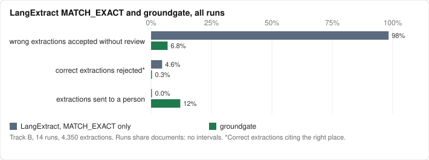

# Benchmark

The IRS example shows groundgate on one document. This benchmark asks the same question at a
larger scale: when an extractor running through LangExtract gets a value wrong, how often does
the wrong value reach you without anyone looking at it, and how much work does groundgate add
to stop it?

The numbers are in [RESULTS.md](RESULTS.md). This page covers how they were made and where the
method is weak. [Results by spec version](#results-by-spec-version) has the results of each
version, from spec 0.1 on this set to the sets of later versions.

## Documents

30 public-domain US government documents in three kinds. I picked each set with a fixed rule
before running any model, so the set was not chosen for what groundgate catches.

| Kind | Documents | Text used | How they were picked |
|---|---|---|---|
| FDA drug labels (DailyMed SPL) | 10 | sections 2 and 3: dosage, dosage forms and strengths | for each of ten common generic drugs, the first tablet label DailyMed search returns |
| NTSB aviation accident reports | 10 | the whole report | the first ten report ids from 192700 up that are final reports of 8 pages or fewer |
| IRS publications | 10 | pages 1 and 2 | the first ten from a list of common publications with at least 8 dollar amounts on those pages |

Metformin and IRS Publication 590-A are excluded because I used them while building groundgate.

`sources.json` pins each download by URL and SHA-256. `fetch.py` downloads them, checks the
hashes, and writes the text to `docs/` with groundgate's own extractor. The text is committed,
so the benchmark scores offline after a publisher revises a document.

## Gold

Each document has its own fields (5 per FDA label, 12 per NTSB report, 9 to 14 per IRS
publication), with a description and a unit. Every IRS document also has one field that it
does not state, so hallucinated values have a place to show up.

A model (Claude) drafted the gold with `gold/prelabels.py`. A person then checked every draft
fact and absence in the labeling app ([label/README.md](label/README.md)), which never shows what
the benchmarked models extracted. Only checked facts count. The gold files record who checked
each document, when, and how long it took.

The check took 2.4 hours and kept nearly all of the draft. It excluded one field as ambiguous,
found one field the draft had called absent (levothyroxine is dosed from birth, so the youngest
pediatric age is 0), and added two places as evidence.

An extraction is **correct** when its value is a gold value for its field and its unit is the
field's unit. It is **wrong** when the value differs, the field is absent from the document, the
unit differs, or the value is not a number. Off-schema field names are counted but not scored.
Separately, a correct extraction *cites the right place* when its span overlaps one of the gold
evidence spans.

## Track A: planted errors

No model is called. For every gold fact, `score.py` builds the extraction a model would emit if
it read the right place: the gold text as `extraction_text`, the value and unit as attributes.
It then plants one error at a time:

| Planted | What changes |
|---|---|
| value attribute x10, text right | the value attribute only |
| value and text x10 | both, consistently |
| one digit changed | both; the second digit moves by 2 |
| decimal point dropped | the value attribute: 0.4 hours read as 4 |
| comma read as a decimal point | the value attribute: $184,500 read as 184.5 |
| wrong unit | the unit attribute (mg to mcg, USD to cents, and so on) |
| "null" as the value | the text and value become the literal `null` |
| a nearby number with the same unit | both become another real number from the same chunk |

Two more classes leave the extraction alone and change the document instead, so the value is
no longer what the text means:

| Planted | What changes |
|---|---|
| "more than" written before the value | the document; skipped for fields whose comparator is already "more than" |
| "million" written after the value | the document; dollar and unitless fields only |

Two controls stay correct: the clean extraction, and one whose text is paraphrased ("10
milligrams" for "10 mg"). Plantings that happen to land on another gold value for the field
are skipped.

Each extraction is aligned by LangExtract's own `Resolver.align`, inside the same 1,000-character
chunk `lx.extract` would have sent to the model, then passed through the real groundgate adapter
and `admit`. So Track A measures the two systems' checks against each other with nothing else
varying.

## Track B: real models

`propose.py` runs `lx.extract` over every document with each model, at LangExtract's default
chunk size (`max_char_buffer=1000`) and at 4,000. The prompt gives field names, units and
descriptions, plus one invented example per kind. It never sees the gold. Every run is cached
in `runs/` with the raw model output for each chunk, so scoring never calls a model.

Each extraction is scored under four rules:

- **LangExtract, all**: accept everything `lx.extract` returns.
- **LangExtract, aligned**: accept anything with a character interval.
- **LangExtract, MATCH_EXACT**: accept only exact alignments. This is the strictest setting
  LangExtract offers, and the fair comparison.
- **groundgate**: accept what it admits, send what it flags to review, drop what it rejects.

Groups of models also go through one `admit` call together (every pair, and all models), so
a disagreement on a single-valued field is flagged `CONFLICTING_CANDIDATES`. Each group is
compared with the same candidates admitted one model at a time.

| Model | Through | Setting |
|---|---|---|
| Gemini 3.6 Flash | Antigravity CLI | Medium |
| Gemini 3.8 Flash | Antigravity CLI | Low, the cheapest setting of the newest Flash |
| GPT-5.6 Luna | Codex CLI | medium reasoning effort |
| GPT-5.6 Terra | Codex CLI | medium reasoning effort |
| Claude Sonnet 5.5 | Claude Code CLI | default |
| Claude Haiku 4.5 | Claude Code CLI | default |
| Claude Sonnet 4.6 | Claude Code CLI | default; an older model, kept as a baseline |

`RESULTS.md` also reports, per run: which reason code stopped each wrong extraction, how often
a correct value was admitted or rejected while citing a place the gold does not list, results
by source, and harness health (chunks, replies LangExtract could not parse, replies discarded
for tool use, seconds per document).

The metrics:

- **escaped**: wrong extractions accepted without review, as a share of wrong extractions;
- **false rejects**: correct extractions that cite the right place and are rejected;
- **review load**: extractions groundgate sends to a person, as a share of all scored ones;
- **recall**: gold facts with at least one correct extraction admitted (or admitted or sent to
  review).

Rates carry 95% Wilson intervals. With a few dozen wrong extractions per run, they are wide.

## What groundgate cannot catch

groundgate checks that the value is in the cited text with the right unit and no qualifier the
field doesn't allow. It cannot tell whether that text is the right place. When a model cites a
real "20 mg" as the tablet strength and the label only sells 10 mg tablets, every check passes.
Track A's "nearby number with the same unit" row measures this directly, and the Track B
appendix lists every real case.

In the real runs, this was six of the eight escapes. Each took a value stated for another
condition: five models took metoprolol's heart failure maximum as the hypertension maximum, and
one took lisinopril's renal impairment dose. The FDA fields name one condition ("the first
indication in section 2") because a v0.1 field holds one value per document. A field whose value
depends on a condition, checked against the condition's words near the evidence, is a candidate
for the next spec version.

The other two read levothyroxine's "1.6 mcg/kg/day" as a flat 1.6 mcg. The unit rule finds `mcg`
right after the number and does not look further.

## Caveats

- **The spec is frozen for this benchmark.** Scoring uses SPEC 0.1 as of commit `9245852`. While
  building the scorer I saw three known weaknesses in the draft numbers: "increased from $70,000
  to $72,000" reads as a range and is flagged; "must not be more than" is flagged even when the
  field is the limit itself; and "$1 million" is rejected for the value 1000000 because scale
  words only flag. I did not fix them here, because fixing them against this set would tune the
  rules on the test data. Fixes go into a later spec version and get measured on new documents.
- **One fix to the code, none to the spec.** At 4,000 characters, LangExtract's chunker cut
  "Altimeter Setting: 29.97" after "29.", and three models answered 29 from that chunk. The spec
  says a span never reads a prefix of a longer number, but the code only checked for that when the
  span ended right on a digit, so it admitted 29. I fixed the code to match the spec and added a
  conformance vector. The results are from the fixed code; before the fix, these three also
  escaped (11 of 117, not 8).
- **Who drafted the gold.** Claude drafted it, and three Claude models (Sonnet 4.6, Sonnet 5.5,
  Haiku 4.5) are among the benchmarked ones. A person checked every fact without seeing model
  output, but drafts anchor judgment. The check changed little, and from here I can't tell a good
  draft from an anchored checker.
- **How the models were called.** Every model ran through a logged-in agent CLI, not a raw API.
  Antigravity runs in its sandboxed plan mode with a no-tools preamble. Codex runs `codex exec`
  in an empty directory with a read-only sandbox, my user config, rules and AGENTS.md ignored,
  and no saved session; its event stream shows every tool call, and a reply that used one is
  discarded and retried. Claude Code runs `claude -p` in an empty directory with no tools, MCP
  servers, skills or setting sources, so no CLAUDE.md, hooks or memory load, and a one-line
  system prompt replaces the default; a reply from a fallback model or with more than one turn
  is discarded. Antigravity and Codex add their own system prompt, and temperature is not
  under my control in any of them, so a rerun gives different extractions. The cached runs are
  what was scored. `propose.py` also supports LangExtract's native Gemini provider.
- **The prompt changed once, before the full runs.** The first prompt described the output
  with the words `extraction_class` and `extraction_text`, and GPT-5.6 answered in that shape
  instead of the one LangExtract parses, so its chunks were dropped. The final prompt describes
  the layout the examples use and says to leave `unit` out for unitless fields. I discarded
  every run made with the first prompt, about 30 documents, and reran all models on the same
  final prompt.
- **Dropped chunks.** When a model's reply for a chunk isn't valid JSON, LangExtract logs a
  warning and skips the chunk. In an early trial GPT-OSS 120B in plan mode wrote a plan file and
  replied with a link to it instead of JSON. Haiku 4.5 and Sonnet 4.6 answered some IRS chunks,
  mostly tables of contents, with a note that they saw no document, or with prose before the
  JSON, instead of an empty list. Those facts count against recall for every rule equally. The
  raw replies are in the run files, with home directory paths replaced by `~`.
- **"Cited the right place" is only as good as the gold evidence.** A label often states the
  same value in several places. A citation counts as right only when the checker listed that
  place, so this rate is a lower bound.
- **Not every model I tried was available.** At the time of these runs, GPT-6 Luna was not
  offered to a ChatGPT account in Codex, so GPT-5.6 Terra took its place. It is offered now, and
  the held-out 10-K set (`bench/sec3`, #170) uses `gpt-6-luna`.
- **Small n.** 30 documents and seven models is enough to show where the failure classes are,
  not to rank models.

## Reproduce

```bash
uv sync --group langextract
uv run python bench/fetch.py                                   # optional: re-download and verify
uv export --only-group langextract --no-emit-project --no-hashes -o /tmp/bench-req.txt
uv run --isolated --no-project --with groundgate==0.1.0 --with-requirements /tmp/bench-req.txt \
    python bench/score.py                                      # rescore from the cached runs
uv run --group langextract python bench/propose.py --provider gemini --model <model id>  # new runs
```

These results are for spec 0.1, so they are scored with the released groundgate 0.1.0, not the
code in `src/`. Later spec versions are measured on a separate set of documents. CI runs
`score.py --check` the same way, which fails if `RESULTS.md`, `results.json` or the charts differ
from what the cached runs and gold produce.

The scripts take `--set <dir>` for another benchmark set with the same layout (`sources.json`,
`docs/`, `gold/`, `runs/`). The default is this one.

## Results by spec version

### Spec 0.1 on the first set

Seven models (Gemini, GPT and Claude, each through its own CLI) ran through LangExtract on 30
public-domain FDA drug labels, NTSB accident reports and IRS publications, at two chunk sizes. A
person checked every gold fact. These are spec 0.1's numbers on the first set, as published. Of 4,350 extractions, 117 were wrong: the wrong value, a value
for a field the document doesn't state, the wrong unit, or not a number.



| | LangExtract, `MATCH_EXACT` | groundgate |
|---|---:|---:|
| wrong extractions accepted without review | 98.3% (115/117) | 6.8% (8/117) |
| correct extractions citing the right place, rejected | 4.6% (194/4,233) | 0.3% (14/4,233) |
| extractions sent to a person | 0% | 12.1% (526/4,350) |
| gold facts admitted with a right value | 92.5% (3,588/3,878) | 87.1% (3,379/3,878) |

A gold fact is one value that a document states for a field, so a field with 12 strengths counts
12 times, and each fact counts once in each run. groundgate admits fewer right facts than
`MATCH_EXACT`, and lets in 8 wrong values instead of 115. With the reviews, 96.5% (3,742/3,878)
of gold facts get a right value.

Of the 526 extractions groundgate sent to a person, 92 were wrong; a random sample that size
would have held about 14. groundgate also rejected 71 correct values that LangExtract had aligned
to a place that doesn't state them: the value was right, the evidence wasn't.

Most catches (84 of 109) were `CONFLICTING_CANDIDATES`: a model proposed two values for a
single-valued field, and groundgate sent both to review instead of picking one.

Six of the 8 that got through are the case groundgate says it cannot catch (see
[What it does not do](../README.md#what-it-does-not-do)). Five models took metoprolol's heart failure maximum
(200 mg) as the hypertension maximum, and one took lisinopril's renal impairment dose as the usual
starting dose. Each number is real and cited correctly; it belongs to another condition. The
other two read levothyroxine's 1.6 mcg/kg/day as a flat 1.6 mcg, which the unit check allows.
Putting all seven models through one gate caught one more, because when they were wrong they
mostly agreed. Spec 0.2 goes after both: keyed fields check the condition, and a dose per
kilogram no longer passes as a flat dose.

The benchmark also found a bug. When LangExtract's chunker cut "29.97" after "29.", groundgate
read the span as 29, which its own spec forbids. It's fixed, and three wrong altimeter settings no
longer get through.

Tables and planted-error results: [bench/RESULTS.md](RESULTS.md). Method and caveats: the
sections above. The write-up, with what got through and why:
[Grounding is a contract, not a citation](https://mohanraj00.github.io/tech/grounding-is-a-contract/).

### Spec 0.2 on a second set

Spec 0.2's rules were written from the escapes above, so they can't be measured on the same
documents. I picked 101 new ones by rules frozen before anyone read them: FDA labels with doses
per indication or per kilogram, IRS publications and Federal Register rules with "increased from",
"must not be more than" and "$1.2 million". The same seven models ran at both chunk sizes. Every
candidate was decided twice, by spec 0.1 (the released 0.1.0 wheel) and by spec 0.2. Pooled over
14 runs on the 74 documents checked in full:

| | LangExtract, `MATCH_EXACT` | groundgate, spec 0.1 | groundgate, spec 0.2 |
|---|---:|---:|---:|
| wrong extractions accepted without review | 85.7% (705/823) | 30.7% (253/823) | 8.8% (72/823) |
| correct extractions citing the right place, rejected | 3.8% (230/6,080) | 11.3% (690/6,080) | 0.5% (28/6,080) |
| extractions sent to a person | 0% | 28.2% (1,950/6,903) | 39.6% (2,730/6,903) |
| gold facts admitted with a right value | 84.6% (4,751/5,614) | 51.0% (2,862/5,614) | 53.2% (2,985/5,614) |

642 of 0.1's 690 false rejects are in the 19 documents picked for amounts like "$1.2 million",
which 0.1 could not match. 82 of its 253 escapes were a right value under the wrong indication;
0.2 lets 10 of those through. It pays in review load. The 72 that still got through are listed
one by one in [bench/set2/RESULTS.md](set2/RESULTS.md), and two rules that need work are
open for the next version (#51, #52).

This set shows the gap that matters most. Spec 0.2 admits a right value for 53.2% of gold facts,
and the reviews bring it to 86.8% (4,873/5,614). Closing that gap without new escapes is the work
of the versions since: the 0.4 key clear and the 0.5 evidence list aim at it, and the next section
measures 0.5.

### Spec 0.5 on new 10-K filings

Spec 0.5 lets the extractor cite each part of a value: the sign, the scale, the unit, the field
and the key. I measured it on 20 10-K filings that the rules did not come from, and on the IRS
filing-status set. One extractor (Claude Haiku 4.5) ran once per set, and every candidate was
decided by spec 0.4 (the released 0.4.0 wheel) and by spec 0.5. A person labeled every admitted
value blind.

| Set | Decision | Right values admitted | Escapes |
|---|---|---:|---:|
| new 10-K set | spec 0.4 | 23 | 1 |
| new 10-K set | spec 0.5 | 26 | 0 |
| IRS filing status | spec 0.4 | 28 | 0 |
| IRS filing status | spec 0.5 | 28 | 0 |

Two rules still cost right values, and neither adds an escape: a unit item fails when the unit is
already next to the number, and a scale quote must match the case of the text. Without the unit
check, spec 0.5 admits 33 right values on the 10-K set. Spec 0.6 changes the unit rule (below).
[bench/evidence/RESULTS.md](evidence/RESULTS.md) has every number.

### Spec 0.6 on a held-out 10-K set

The 0.6 rules came from that 10-K set and the status set, so I measured them on 20 other 10-K
filings (`bench/sec3`). Two extractors ran once each, with `gg.extractor_schema(schema)` as their
structured output and the guide's instructions. Each rule was decided alone, and a person labeled
every admitted value, and every value whose outcome changed, blind.

| Decision | claude-haiku-5-5 | gpt-6-luna | Escapes |
|---|---:|---:|---:|
| spec 0.5 | 15 | 17 | 0 |
| a unit item that repeats the unit passes (#145) | 15 | 27 | 0 |
| a scale quote in any case (#145, not shipped) | 15 | 17 | 0 |
| `between` with words before an `and` range (#159) | 15 | 17 | 0 |
| a heading scale over a table (#162) | 15 | 17 | 0 |

The numbers are right values admitted. The unit rule admits 10 more right values on one run. The
scale rule admits none more, so it did not ship. #159 and #162 only add flags, and they cost no
right value. [bench/sec3/RESULTS.md](sec3/RESULTS.md) has every number.

### Spec 0.7 on held-out agency reports

The 0.7 unit rule (#164) came from the 10-K sets and the status set, so I measured it on the
principal statements of 20 FY2025 agency financial reports (`bench/afr`). The same two
extractors ran once each, and a person labeled every admitted value blind.

| Decision | claude-haiku-5-5 | gpt-6-luna |
|---|---|---|
| spec 0.6 | 3 right, 1 escape | 6 right, 0 escapes |
| spec 0.7 | 3 right, 1 escape | 6 right, 0 escapes |

The numbers count admitted values. Each run made 100 proposals, and the rule changes the
outcome of none of them. Most proposals fail on the field or the key citation before the unit
matters. [bench/afr/RESULTS.md](afr/RESULTS.md) has every number.

### Spec 0.8 on held-out state and agency reports

0.8 is about yield. I measured each change on documents that it did not come from: the 20 agency
reports of `bench/afr` for the PDF table rows of #230, 10 FY2025 state ACFRs (`bench/acfr`) for
#242, 10 more (`bench/acfr2`) for #249, #250 and #256, and 10 drug labels (`bench/strings`) for
#140. A person labeled every admitted value blind. #242, #250 and #140 change no decision on their
sets, so the table leaves them out.

| Change | Set | claude-haiku-5-5 | gpt-6-luna |
|---|---|---|---|
| PDF table rows as lines with tabs (#230) | `bench/afr` | 3 to 73 right, 1 to 0 escapes | 6 to 74 right, 0 escapes |
| The value where the field item passes, a column unit (#249) | `bench/acfr2` | 5 to 7 right, 0 escapes | 2 to 2 right, 0 escapes |
| No role `key` on a field with no keys (#256) | `bench/acfr2` | 10 to 23 right, 0 escapes | 0 to 9 right, 0 escapes |

The numbers count admitted values. The #230 rows compare the 0.7 text under spec 0.7 with new
runs on the new text under 0.8. #249 and #250 came from `bench/afr`, so the #230 rows include
their effect on that set (#263). The #256 rows ask a schema with no keys on its fields, so they do not compare with
the #249 row. [bench/afr/tabs/RESULTS.md](afr/tabs/RESULTS.md),
[bench/acfr/RESULTS.md](acfr/RESULTS.md), [bench/acfr2/RESULTS.md](acfr2/RESULTS.md),
[bench/strings/RESULTS.md](strings/RESULTS.md) and
[bench/acfr/keyrole/RESULTS.md](acfr/keyrole/RESULTS.md) have every number.

### Spec 0.9 on requested fields

0.9 is about misses on the fields that an app asks for. `bench/requested` has 61 held-out documents
in three kinds that no rule came from: 20 component datasheets, 20 health plan SBCs and 21 annual
reports. Each kind has one fixed field list, and a person labeled each field blind before any model
output. The documents state 196 of the labeled values. Both arms use `gpt-6.1-sol` at medium effort.

| Arm | Right values admitted | Right absences | Escapes | Reviews | Silent misses | Miss rate |
|---|---:|---:|---:|---:|---:|---:|
| One-pass extraction with feedback (baseline) | 9 | 0 | 1 | 69 | 118 | 95.41% |
| `groundgate.extract` | 16 | 6 | 0 | 119 | 61 | 91.84% |

The loop halves the silent misses and admits no wrong value, but both arms still miss more than 90%
of the stated values. The loop did not complete 18 of the 21 annual reports: each stopped at a
harness limit. [bench/requested/RESULTS.md](requested/RESULTS.md) has every number.

### Spec 0.10 on requested fields

0.10 is about fewer reviews of right values. `bench/requested3` has 111 held-out documents in
four kinds that no rule came from: 18 component datasheets, 23 health plan SBCs, 20 annual
reports and 50 safety data sheets, a new kind. Each kind has one fixed field list. Two blind passes
labeled each field from the original PDFs before any model output. The documents state 305 of
the labeled values. The baseline and `groundgate.extract` use `gpt-6.1-sol` at medium effort. The
`drop_rounded` arm makes no model call: it replays the calls of `groundgate.extract`.

| Arm | Right values admitted | Right absences | Escapes | Reviews | Silent misses | Miss rate |
|---|---:|---:|---:|---:|---:|---:|
| One-pass extraction with feedback (baseline) | 115 | 0 | 2 | 142 | 48 | 62.30% |
| `groundgate.extract` | 97 | 118 | 0 | 160 | 48 | 68.20% |
| `groundgate.extract` with `drop_rounded` | 99 | 118 | 0 | 158 | 48 | 67.54% |

`groundgate.extract` admits no wrong value. The baseline admits 2 wrong values of 117. But
`groundgate.extract` misses more right values than the baseline: 208 of 305 (68.20%) against 190
of 305 (62.30%). The silent misses are the same (48), so the difference is right values that
it sends to review and the baseline admits. It did not complete 15 of the 20 annual reports and
4 of the 18 datasheets: each stopped at a harness limit. Its annual miss rate is 97.06%, against
73.53% for the baseline. Every arm misses more than 60% of the stated values, so 0.10 does
not meet the goal on this set. [bench/requested3/RESULTS.md](requested3/RESULTS.md) has
every number.

### Spec 0.11 on requested fields

`bench/requested4` has 91 documents in the four kinds and field lists of `bench/requested3`. It
is the first set with a development split and a held-out split: a hash of the source family puts
32 documents in development and 59 in held-out. Two blind passes labeled each field from the
original PDFs before any model output. The learning loop ran only on the development split, and
the code froze before the first held-out model call. The 59 held-out documents state 204 of the
labeled values. The arms are the arms of 0.10, with `gpt-6.1-sol` at medium effort.

| Arm | Right values admitted | Right absences | Escapes | Reviews | Silent misses | Miss rate |
|---|---:|---:|---:|---:|---:|---:|
| One-pass extraction with feedback (baseline) | 76 | 0 | 1 | 103 | 25 | 62.75% |
| `groundgate.extract` | 79 | 0 | 1 | 97 | 28 | 61.27% |
| `groundgate.extract` with `drop_rounded` | 81 | 0 | 1 | 95 | 28 | 60.29% |

`groundgate.extract` misses 125 of 204 (61.27%) and the baseline misses 128 of 204 (62.75%).
Each arm admits 1 wrong value. The gap of 3 misses is inside the run noise of the development
split, so I do not claim a difference between the arms. No document stopped at a harness limit.
`groundgate.extract` reports no absence on this set: 0 right absences and 76 unreported
absences. The cause: #382 cuts a region longer than 6,000 characters, a cut marks the search
truncated, and the bench writes an absence only for a search that is not truncated. The queries
of each field include words such as "the" and "and", so the regions cover most of the document.
So its miss rate is not comparable with the 0.10 `groundgate.extract` on `bench/requested3`. 0.12
takes these words out of the queries (#466, #493). 0.13 changes the search again (#494). The absence problem is open for 0.14 (#464).
Every arm misses more than 60% of the stated values, so 0.11 does not meet the goal on this set.
[bench/requested4/RESULTS.md](requested4/RESULTS.md) has every number.

A judge can clear part of the reviews. A Codex judge (`gpt-6.1-sol`, frozen at threshold 0.9)
answered each of the 104 held-out fields that `groundgate.extract` sent to review with a
candidate, two times. It clears 91 right values in run 1 and 94 in run 2, with no escape. With
these clears, the miss rate would be 16.67% and 15.20%. The judge is a recorded input, not part of
a decision, and these numbers hold for documents that do not attack the model.
[bench/requested4/judge/heldout/RESULTS.md](requested4/judge/heldout/RESULTS.md) has every
number. The review answers of a person did not pass the bar for use as labels: 10 of 132 scored
answers are wrong, with a 95% upper bound of 0.1251 against a bar of 0.05
([bench/requested4/review/RESULTS.md](requested4/review/RESULTS.md)).
